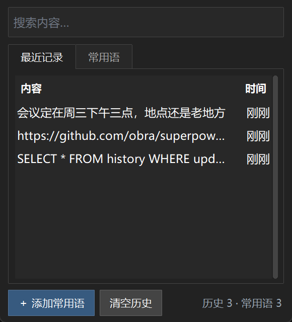
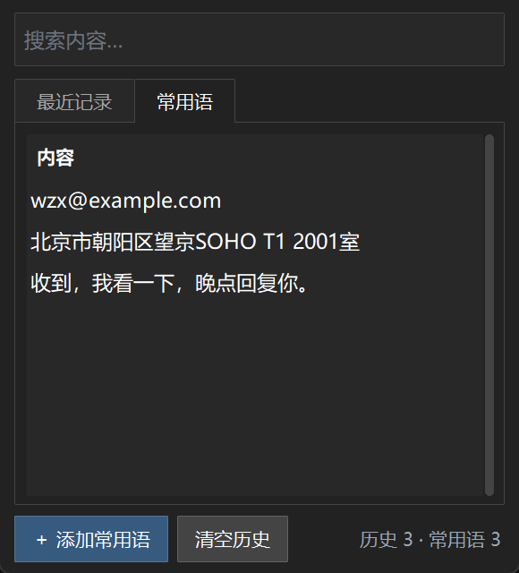

# 剪贴板历史

自动记录你复制过的**文字**，保留 7 天，过期自动清掉。想用的时候点托盘图标翻出来，
选中哪条就放回剪贴板，你按 Ctrl+V 粘出来。

另外有一块**常用语**：自己存几条经常要粘的内容（地址、邮箱、固定话术），
它不受 7 天限制，永远不会被自动删掉。




---

## 怎么启动

双击 **`启动.vbs`**（推荐，不会闪黑框）。

也可以双击 `启动.bat`，效果一样，只是会闪一下黑框。

**开机自动启动**：本机已经把 `启动.vbs` 的快捷方式放进开机启动文件夹了，不用手动开。
换一台机器需要自己再放一次（见下面「怎么取消开机自启」里的路径）。

## 怎么关

在右下角托盘找到蓝色方块图标 → **右键** → **退出**。

⚠️ 点窗口右上角的 × 只是把窗口收起来，程序还在后台记录。这是故意的——
不然一关窗口就记不到东西了。

## 怎么用

- **点一下某条记录** = 复制它，然后去别的地方 Ctrl+V
- **右键某条记录** = 删除这条 / 编辑（常用语）
- **搜索框** = 打字就实时过滤，Esc 清空
- **页签** = 左边「最近记录」（7 天内的），右边「常用语」（永久的）
- **暂停记录** = 托盘右键勾上，那段时间复制的东西不记

## 数据存在哪

```
程序目录\data.db
```

一个 SQLite 文件，**明文**。里面有你的剪贴板内容，如果复制过密码之类的，
懂电脑的人打开这个文件能读到。目前没有加密。

## 怎么备份

复制 `data.db` 这一个文件就是完整备份。要恢复就把它放回去覆盖。

建议：先托盘退出，再复制，避免文件正被写入。

## 怎么取消开机自启

删掉这个文件就行：

```
%APPDATA%\Microsoft\Windows\Start Menu\Programs\Startup\剪贴板历史.vbs
```

## 出问题看哪里

```
程序目录\run.log
```

程序用 `pythonw` 跑，没有黑窗口，所以出错不会在屏幕上显示，全写在这个日志里。

常见情况：

| 症状 | 原因 | 怎么办 |
|---|---|---|
| 双击没反应，托盘也没图标 | 已经开着一份了（程序只允许一个实例） | 看右下角托盘，或者任务管理器里看有没有 pythonw.exe |
| 托盘图标不见了 | 可能被折叠进「^」里了 | 点任务栏的 ^ 展开看看 |
| 复制了东西但列表里没有 | 内容超过 10 万字 / 是图片 / 暂停记录了 | 图片和文件不记录，这是设计如此 |
| 窗口打开但列表是空的 | 刚启动，还没复制过东西 | 复制一段文字试试 |

## 文件说明

| 文件 | 作用 |
|---|---|
| `main.py` | 主程序：托盘、轮询剪贴板、定时清理 |
| `ui.py` | 窗口界面（深色主题） |
| `store.py` | 数据库读写，所有 SQL 都在这里 |
| `clipboard.py` | 调用 Windows API 读写剪贴板 |
| `tray.py` | 托盘图标和右键菜单 |
| `启动.vbs` / `启动.bat` | 启动器 |
| `自检.py` | 改完代码跑一下，全部检查通过才说明没改坏 |
| `data.db` | 你的数据 |
| `docs/spec/` | 开发时的需求文档和实施方案 |

## 环境要求

- Windows（用到 `ctypes` 调 Win32 剪贴板 API，只能在 Windows 上跑）
- Python 3.10+（本机用的是 3.14.6）
- 依赖只有两个：`pystray`（托盘图标）、`ttkbootstrap`（深色主题）

```bash
pip install pystray ttkbootstrap
```

## 从源码跑起来

首次运行不需要准备数据库——程序启动时如果没找到 `data.db` 会自己建表。

```
python main.py       # 前台跑，能看到日志输出
pythonw main.py      # 后台跑，没有黑窗口（启动.vbs 用的就是它）
```

## 改代码的话

程序不会热重载，改完 `.py` 要：托盘右键退出 → 重新双击 `启动.vbs`。

改完先跑一遍自检（用的是临时数据库，不会动你的真实记录）：

```
python 自检.py
```

看到「失败 0 项」再重启程序。
